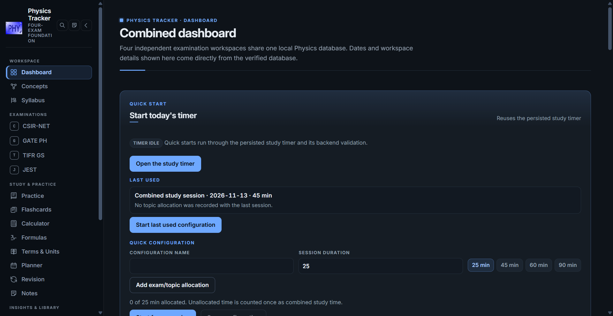
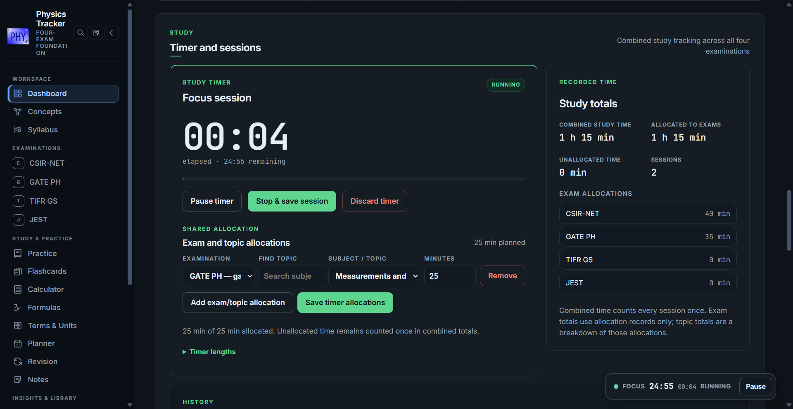
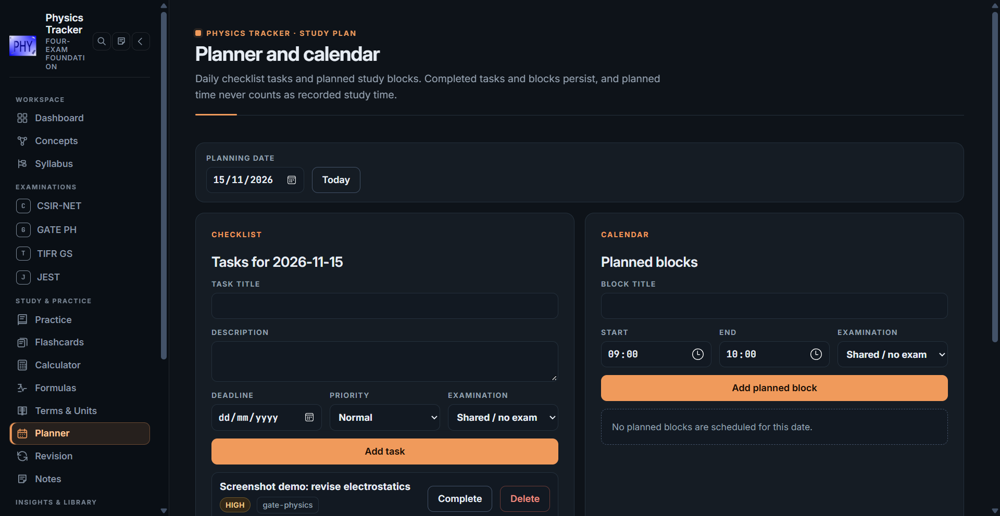
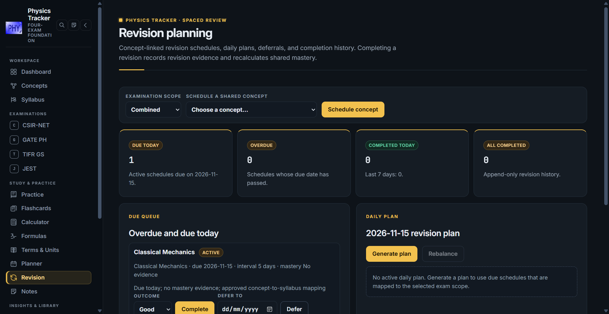
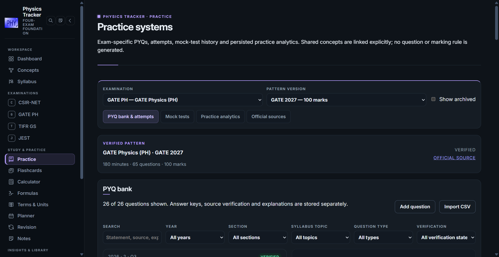
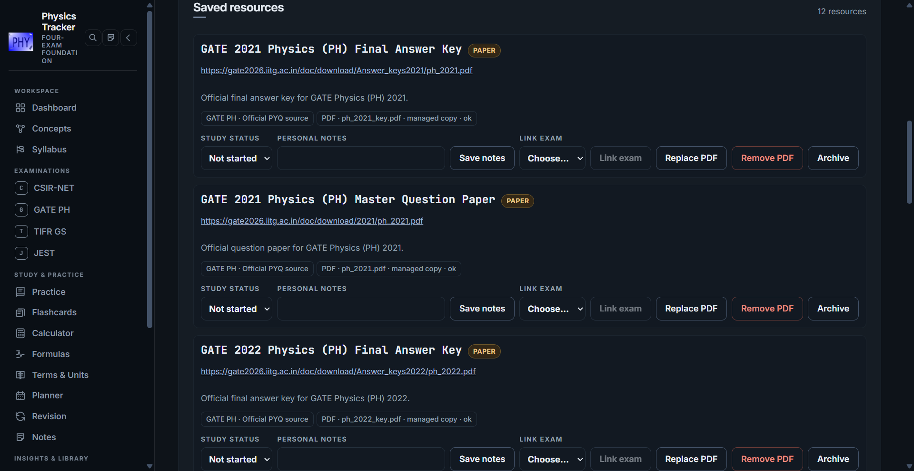
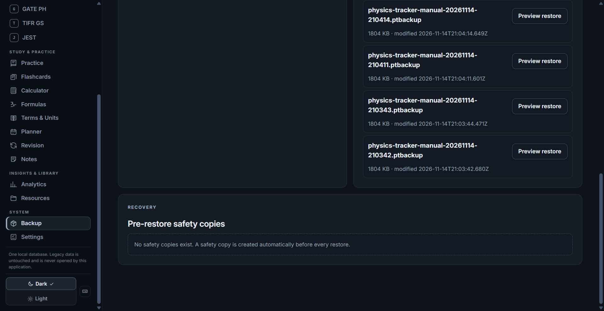

# Physics Tracker

[](https://github.com/CrimsonVisa/Physics-exam-Tracker/actions/workflows/ci.yml)
[](LICENSE)
[](docs/DEVELOPMENT.md)
[](CHANGELOG.md)

Physics Tracker is a local-first Windows desktop study app for four physics entrance examinations.
It keeps syllabus progress, focused study sessions, planning, practice, revision, reference
material, notes, and analytics in one place.

Use it to decide what to study next, record focused sessions, practise previous-year questions, and
see which topics need another pass before the exam. The current application version is **2.1.0**.

Physics Tracker is an independent study tool. It is not affiliated with or endorsed by any
examination authority.

## Screenshots

Genuine screenshots from Physics Tracker, captured with disposable demo data. The gallery uses
the dark theme.



### Plan and focus

| Study timer                                                                                                    | Planner                                                                                      | Revision planning                                                                             |
| -------------------------------------------------------------------------------------------------------------- | -------------------------------------------------------------------------------------------- | --------------------------------------------------------------------------------------------- |
|  |  |  |

### Practice and data safety

| Practice                                                                                        | Resources                                                                                               | Backup                                                                                     |
| ----------------------------------------------------------------------------------------------- | ------------------------------------------------------------------------------------------------------- | ------------------------------------------------------------------------------------------ |
|  |  |  |

## Supported examinations

| Examination                    | Code               |
| ------------------------------ | ------------------ |
| CSIR-UGC NET Physical Sciences | `csir-net-physics` |
| GATE Physics (PH)              | `gate-physics`     |
| JEST Physics                   | `jest-physics`     |
| TIFR GS Physics                | `tifr-gs-physics`  |

Each examination has its own workspace, while notes, reference material, and the local database are
shared across the application.

## Key features

### Plan and focus

- Combined dashboard with configurable sections, today's study summary, and four exam cards.
- Focus, short-break, and long-break timers with pause/resume, recovery after sleep or restart, and
  session history.
- Manual study sessions and time allocation across examinations and syllabus topics.
- Checklist tasks, planned study blocks, calendar views, exam dates, and rescheduling.
- Spaced-repetition revision schedules, daily revision plans, workload limits, and deferrals.

### Work through the syllabus

- Syllabus trees based on official exam sources, with source and version metadata.
- Topic progress, priority, confidence, notes, search, and completion filters.
- Shared concept library with exam mappings, mastery evidence, and review history.
- Clear separation between shared concept mastery and exam-specific syllabus completion.

### Practise and revise

- Previous-year question bank with source, year, section, topic, and verification metadata.
- Question-level practice with MCQ, MSQ, and numeric-answer support.
- Mock-test workflows with paper patterns, answer keys, scoring, and practice analytics.
- Flashcards with review scheduling, active recall, due queues, and retention history.
- Scientific calculator with memory, previous-answer reuse, angle modes, keyboard support, and
  session history.

### Reference material and notes

- Formula reference with equations, symbols, assumptions, conventions, and syllabus links.
- Terms and SI units reference with aliases, notation, dimensions, and conversion information.
- Built-in physical constants with values, uncertainty, precision, and source metadata.
- User-managed formulas, units, constants, and searchable local notes.
- Sticky notes with quick capture, pinning, colours, search, and optional exam/topic links.
- Local resource catalogue with external links, study progress, and managed PDF copies.

### See progress and protect your data

- Study trends, consistency, practice outcomes, syllabus completion, and weak-topic summaries.
- Accessible charts with equivalent data tables.
- Verified SQLite backup and restore with manifests and checksums.
- Automatic backup retention, CSV exports, and versioned JSON export/import.
- Dark and light themes, adjustable typography, keyboard navigation, focus states, and reduced-motion
  support.

## Download and install

### v2.1.0 release

The v2.1.0 release is distributed through GitHub Releases:

[GitHub Releases — Physics Tracker v2.1.0](https://github.com/CrimsonVisa/Physics-exam-Tracker/releases/tag/v2.1.0)

The release asset is the per-user NSIS installer:

[Download Physics.Tracker_2.1.0_x64-setup.exe](https://github.com/CrimsonVisa/Physics-exam-Tracker/releases/download/v2.1.0/Physics.Tracker_2.1.0_x64-setup.exe)

**SHA-256:**

```text
15E0117D3C1161E5241ADC0FE43AF7638E34D8A6316BDCA3696605B83376429A
```

After downloading, verify the file from PowerShell:

```powershell
Get-FileHash ".\Physics.Tracker_2.1.0_x64-setup.exe" -Algorithm SHA256
```

The reported hash must match the value above before you run the installer.

### Install

1. Download `Physics.Tracker_2.1.0_x64-setup.exe` from the link above.
2. Verify the SHA-256 checksum.
3. Run the installer. It installs for the current Windows user and does not require administrator
   rights.
4. Launch Physics Tracker from the Start Menu or the desktop shortcut.

The installer is **unsigned**, so Windows SmartScreen may display a warning. Verify the checksum
before choosing to run the installer.

Only the per-user NSIS installer is distributed. No portable or standalone build is provided.

### System requirements

- Windows 10 or Windows 11, 64-bit
- Microsoft Edge WebView2 runtime

If WebView2 is not already installed, the installer uses Microsoft's download bootstrapper, so an
internet connection is required for that step. This build does not include an offline WebView2
installer.

## First launch

1. Launch Physics Tracker from the Start Menu or desktop shortcut.
2. No account, sign-in, or remote profile is required.
3. The combined dashboard opens and the local SQLite database is created or opened automatically.
4. Use **Settings** to set your preparation start date and daily study target, and to configure the
   four examination profiles and exam dates.

If the application does not open, see [Troubleshooting](docs/TROUBLESHOOTING.md).

## Your data

Study data stays on the local Windows profile:

```text
%APPDATA%\com.crimsonvisa.physics-tracker\physics-tracker.sqlite3
```

SQLite may create `-wal` and `-shm` sidecars next to the database. Managed PDF/resource copies are
stored separately under:

```text
%APPDATA%\com.crimsonvisa.physics-tracker\resources
```

The WebView2 profile is stored separately at:

```text
%LOCALAPPDATA%\com.crimsonvisa.physics-tracker\EBWebView
```

Backups default to:

```text
%APPDATA%\com.crimsonvisa.physics-tracker\backups
```

Core study features work offline. The application may use the network when you ask it to discover
resources, open an official source, or follow an external reference link.

## Backup and restore

Open **Backup** in the sidebar to manage local database backups.

### Create a backup

1. Optionally enable automatic backups and choose a frequency.
2. Choose an absolute destination folder, or leave it blank to use the default backup folder.
3. Set the retention count (1–100 backups).
4. Select **Save backup settings**.
5. Select **Create backup now** to create a manual backup immediately.

Backups are SQLite database snapshots. They contain the local database and its records/checksums,
but they do **not** contain the bytes of managed PDF/resource files.

To preserve managed PDFs as well:

1. Close Physics Tracker.
2. Copy the entire resources folder shown under **Your data** to the same secure location as your
   backup.
3. Keep the backup file and the resources folder together when moving to another computer.

External resource links are references only; their remote files are not included in a backup.

### Restore a backup

1. Open **Backup**.
2. Select **Preview restore** beside a backup.
3. Review the schema, exam count, and integrity result.
4. Select **Confirm restore** only after the preview is accepted.

Physics Tracker creates a safety copy before every restore and validates the backup schema, exam
records, integrity, and foreign keys before replacing the live database. Do not edit or replace the
live database manually.

Backups and exports are unencrypted. Store them in a location you control and protect them according
to the sensitivity of your study records.

## Privacy

- No account, telemetry, advertising, or remote study-data upload is required.
- Backup and export files are unencrypted; store them securely.
- The active application does not open the retired V1 database.
- 2.x does not automatically import or delete 1.x data.
- The application uses the network only for explicit resource discovery, official-source links, and
  external reference links.

See [docs/PRIVACY.md](docs/PRIVACY.md) for the full privacy statement.

## Troubleshooting

| Problem                                       | What to check                                                                                                                                                                           |
| --------------------------------------------- | --------------------------------------------------------------------------------------------------------------------------------------------------------------------------------------- |
| Windows SmartScreen warns about the installer | The installer is unsigned. Verify the SHA-256 before running it, and only continue if it matches.                                                                                       |
| WebView2 is missing or installation fails     | The installer uses Microsoft's download bootstrapper and needs internet access for that step. Install the Microsoft Edge WebView2 runtime manually if the bootstrapper cannot complete. |
| The app does not open                         | Launch it from the Start Menu, confirm WebView2 is installed, and try reinstalling. Reinstalling does not delete the V2 database.                                                       |
| A backup fails                                | Use an absolute, writable destination folder that is not inside the V1 app-data folder. Retention must be between 1 and 100, and the destination must have free space.                  |
| A restore is rejected                         | The backup may be invalid or from an unsupported schema. Keep the original backup, review the preview, and restore a verified backup instead.                                           |
| A managed PDF is missing                      | Managed PDFs are separate from the database. Use **Relink PDF** or **Attach PDF** on the resource card, or restore the file from your own copy. The app does not modify original PDFs.  |
| Data appears to be missing                    | Confirm you are using the same Windows profile and the database path shown above. Do not create or replace a database manually; restore a verified backup or ask for help.              |

For more detail, see [docs/TROUBLESHOOTING.md](docs/TROUBLESHOOTING.md).

## Support

- **Bug reports and feature requests:** [GitHub Issues](https://github.com/CrimsonVisa/Physics-exam-Tracker/issues)
- **Security vulnerabilities:** follow [SECURITY.md](SECURITY.md), not a public issue

When reporting a bug, include:

- Physics Tracker version
- Windows version
- clear reproduction steps using disposable data
- screenshots or logs only after removing personal study data, credentials, databases, backups, and
  PDFs

Do not attach real databases, backups, personal notes, exam PDFs, credentials, or private keys.

## Build from source

Source builds require:

- Windows 10 or Windows 11, 64-bit
- Microsoft Edge WebView2 runtime
- Node.js 22.12 or newer
- Rust 1.95 or newer with the `x86_64-pc-windows-msvc` toolchain
- Visual Studio with the **Desktop development with C++** workload and a Windows SDK

```powershell
git clone https://github.com/CrimsonVisa/Physics-exam-Tracker.git
cd Physics-exam-Tracker
npm ci
npm run tauri:dev
```

For a production build:

```powershell
npm run tauri:build
```

If PowerShell blocks the npm shim, use `npm.cmd` instead of `npm`. The full development and release
instructions are in [docs/DEVELOPMENT.md](docs/DEVELOPMENT.md) and [docs/RELEASE.md](docs/RELEASE.md).

Do not use a live user database, personal study data, or exam PDFs during development.

## Technology stack

- **Desktop shell:** Tauri 2
- **Frontend:** React 19, TypeScript, Vite
- **Backend:** Rust
- **Storage:** SQLite through `rusqlite`
- **Mathematics:** KaTeX
- **Testing:** Vitest and Rust tests

## Documentation

- [Feature guide](docs/FEATURES.md)
- [Architecture](docs/ARCHITECTURE.md)
- [Privacy and data handling](docs/PRIVACY.md)
- [Troubleshooting](docs/TROUBLESHOOTING.md)
- [Development guide](docs/DEVELOPMENT.md)
- [Release process](docs/RELEASE.md)
- [v2.1.0 release notes](docs/releases/RELEASE_NOTES_2.1.0.md)
- [v2.0.0 release notes](docs/releases/RELEASE_NOTES_2.0.0.md)
- [Changelog](CHANGELOG.md)

## Project structure

```text
src/main.tsx                  Active V2 frontend entry point
src/v2/                       Active React application
src/components/               Shared active components plus retained V1 components
src/lib/                      Shared active utilities plus retained V1 API wrappers
src-tauri/src/v2/             Active Rust backend, schema, and seed data
src-tauri/src/*.rs            Tauri entry, shared helpers, and retained V1 Rust modules
src-tauri/capabilities/       Tauri permissions
src-tauri/nsis/               Installer template
legal/                        MIT and third-party licence bundle
docs/                         Architecture, features, privacy, development, troubleshooting, and release docs
tools/schema-validation/      Historical initial-schema specification and validator
```

The active V2 frontend is under `src/v2`, and `src-tauri/src/v2` is the active Rust backend. The
`src/components` and `src/lib` folders contain shared modules used by the active shell together with
retained V1 components and API wrappers.

Legacy V1 frontend, backend, and migrations remain in the repository for historical compatibility.
They are not part of the active V2 startup path; do not delete them without a separate migration and
product decision.

## Contributing

Contributions are welcome. Read [CONTRIBUTING.md](CONTRIBUTING.md) before opening a pull request.

- Report security issues through [SECURITY.md](SECURITY.md), not a public issue.
- Follow the [Code of Conduct](CODE_OF_CONDUCT.md).
- Do not include databases, backups, personal study records, exam PDFs, or secrets in issues or pull
  requests.
- Run `npm.cmd run check` before requesting review.

## License

Physics Tracker is released under the **MIT License**. See [LICENSE](LICENSE).

Bundled fonts and third-party dependencies remain under their own licenses; see
[THIRD_PARTY_NOTICES.md](THIRD_PARTY_NOTICES.md).
